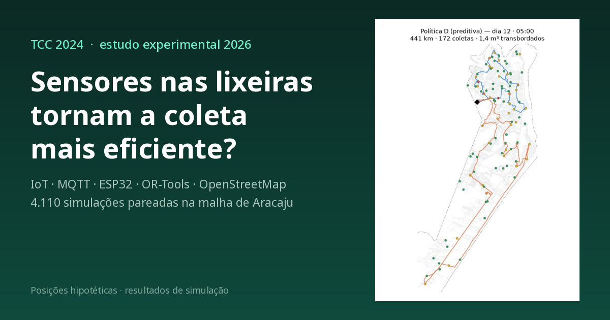
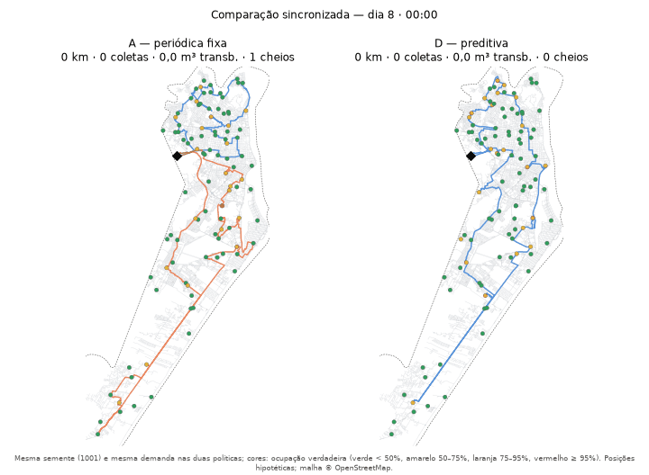
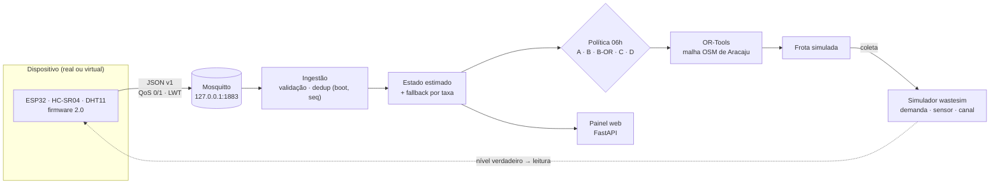
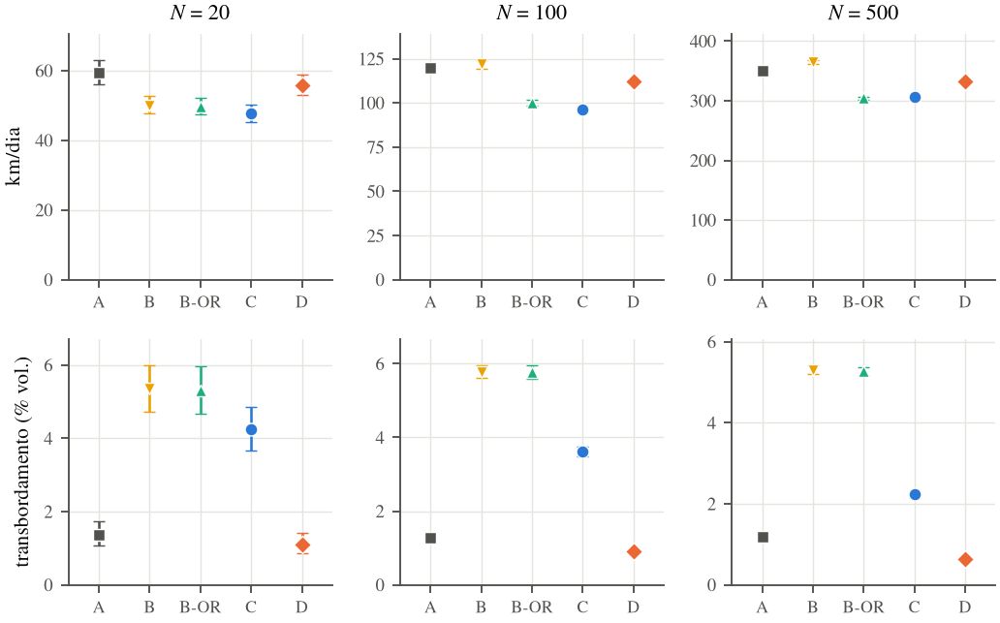
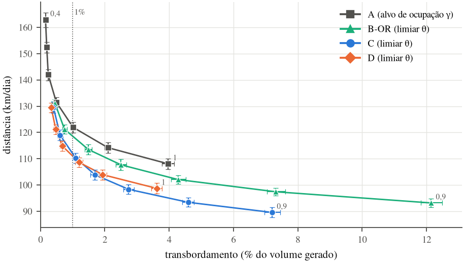
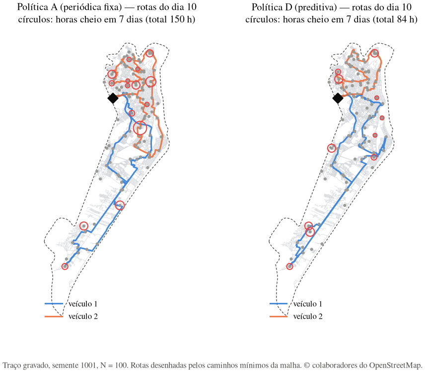
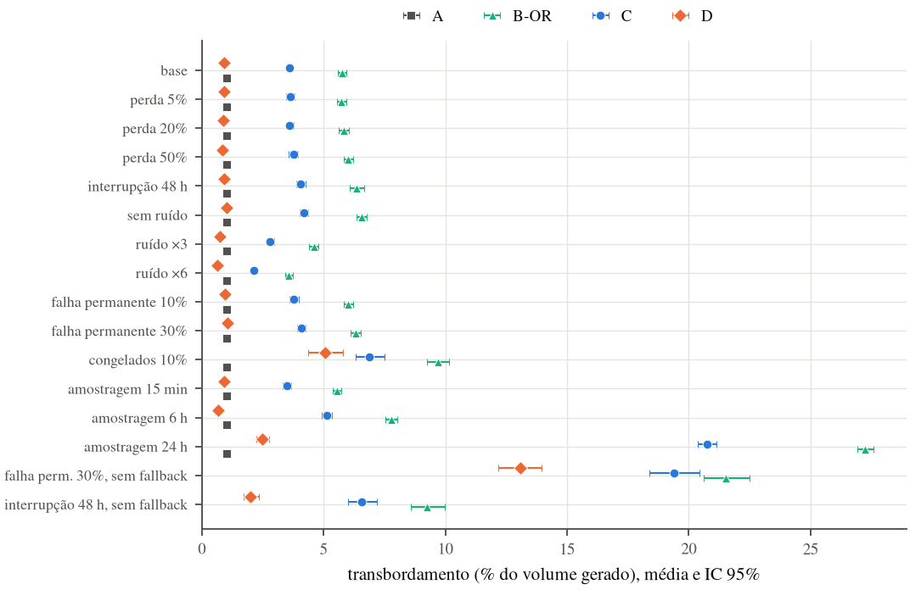
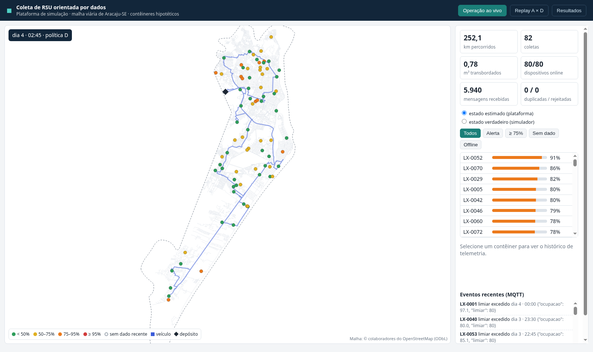
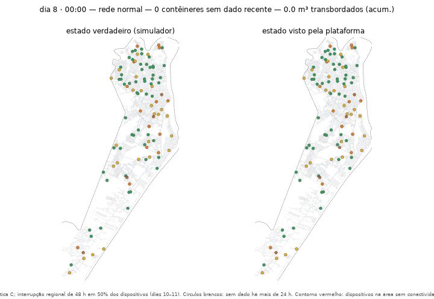

<p align="center">
  <a href="https://jovinull.github.io/coleta-sob-medida/"></a>
</p>

<h1 align="center">Coleta Sob Medida</h1>

<p align="center"><i>Monitoramento IoT com MQTT e coleta de resíduos sólidos urbanos orientada por dados</i></p>

<p align="center">
  <a href="https://jovinull.github.io/coleta-sob-medida/"></a>
  <a href="paper/tcc-2026.pdf"></a>
  
  
  
  
  
  <a href="LICENSE"></a>
</p>

<p align="center">
  <b><a href="https://jovinull.github.io/coleta-sob-medida/">Site do projeto</a></b> ·
  <a href="https://jovinull.github.io/coleta-sob-medida/painel/">Painel interativo</a> ·
  <a href="paper/tcc-2026.pdf">Artigo (PDF)</a> ·
  <a href="#reprodução">Reproduzir</a>
</p>

Evolução científica (2026) do TCC *Desenvolvimento de uma Arquitetura de IoT
para Medições e Monitoramento de Resíduos Sólidos* (IFS, campus Lagarto, 2024).
O protótipo com ESP32 e MQTT virou uma **plataforma aberta de simulação** que
responde, com 4.110 execuções pareadas, à pergunta que o motivava: os dados de
nível das lixeiras tornam a coleta mais eficiente? Quando, e quanto?

<p align="center">
  
  <br><sub>Mesma semente e mesma demanda: coleta periódica (A) × preditiva (D) na malha viária de Aracaju. Posições hipotéticas.</sub>
</p>

O projeto reúne:

- **firmware ESP32** (HC-SR04 + DHT11 + MQTT) auditado
  ([27 defeitos documentados](firmware/AUDITORIA.md)) e reescrito;
- **[contrato MQTT 3.1.1](docs/mqtt/contrato-mqtt.md)** com tópicos por
  dispositivo, payload JSON versionado, LWT e regras de ingestão;
- **plataforma de simulação** (`wastesim`): contêineres virtuais, sensor
  ultrassônico com ruído e falhas, canal com perdas, ingestão, estado estimado,
  quatro políticas de coleta e roteirização com OR-Tools, sobre a malha
  viária real de Aracaju (OpenStreetMap);
- **experimentos pareados e reprodutíveis** (E1–E6) com
  [protocolo pré-registrado](docs/protocolo-experimental.md), análise
  estatística, figuras, animações e **painel web**;
- o **artigo** reconstruído (LaTeX, template SBC) em `paper/`.

> **Natureza dos resultados.** Toda avaliação quantitativa é feita por
> simulação. A malha viária é real; as posições dos contêineres e do depósito
> são **hipotéticas**; os perfis de geração são hipóteses ancoradas em dados
> oficiais (SINISA, IBAM). Os resultados não representam o serviço de coleta
> de Aracaju. O firmware novo foi **compilado**, mas **não** executado em placa
> nem no Wokwi. Ver `docs/parametros.md` e a Seção 5 do artigo.

> **Segurança.** O firmware e o README originais (`original/`) publicaram
> credenciais Wi-Fi em texto claro; elas continuam no histórico do Git.
> **Troque a senha dessa rede.** O código novo não contém credenciais.

## Arquitetura



## Resultados principais (simulação; detalhes, IC 95% e testes no artigo)

Cenário-base: 100 contêineres hipotéticos na malha de Aracaju, 30 sementes
pareadas, 28 dias avaliados. A = periódica fixa (com taxas médias verdadeiras),
B = limiar 75% (vizinho mais próximo + 2-opt), B-OR = limiar com OR-Tools,
C = dinâmica com prêmios (OR-Tools), D = preditiva.

| Política | km/dia | Transbordamento (% do volume) |
|---|---:|---:|
| A | 122,0 | 1,01 |
| B | 121,7 | 5,79 |
| B-OR | 100,1 | 5,77 |
| C | 96,2 | 3,61 |
| D | 112,2 | 0,92 (diferença para A não significativa) |

<p align="center">
  
  
</p>

- No **mesmo nível de serviço** (1% de transbordamento), C e D precisaram de
  8,8% e 9,7% menos distância que A; a diferença entre C e D não foi
  significativa.
- Só trocar o roteirizador (B → B-OR) reduziu a distância em ~18%: parte do
  ganho atribuído à "coleta inteligente" vem da roteirização.
- Perda de até 50% das mensagens teve efeito pequeno; a estimativa por taxa
  para dados desatualizados (*fallback*) foi decisiva sob falhas; **sensores
  congelados** (não detectados pela ingestão) foram o pior modo de falha.
- Com mudança de regime da demanda, D transbordou 2,6 p.p. menos que A.
- Com frota insuficiente (1 veículo), nenhuma política evitou o transbordamento.
- E6 (broker Mosquitto local): entrega de 100% com QoS 1 inclusive com
  reinício do broker; LWT detectou as 10 quedas; 50/50 mensagens malformadas
  rejeitadas. Lote e *live* coincidem quando o lote aplica o mesmo
  arredondamento do payload MQTT (sem ele, uma decisão de limiar mudou).

<p align="center">
  
  
</p>

## Painel web e animações

<p align="center">
  
</p>

O painel (FastAPI + JavaScript sem dependências) mostra a operação ao vivo
pelo broker, o replay A × D e os resultados. Uma versão estática, com o replay
interativo, está no [site do projeto](https://jovinull.github.io/coleta-sob-medida/painel/).

| Animação | Conteúdo |
|---|---|
| [`A_enchimento`](animations/A_enchimento.mp4) | ocupação verdadeira de seis contêineres sob a política A |
| [`B_telemetria_mqtt`](animations/B_telemetria_mqtt.mp4) | telemetria recebida pelo Mosquitto no modo *live* |
| [`C_coleta_veiculos`](animations/C_coleta_veiculos.mp4) | veículos executando as rotas da política D |
| [`D_comparacao_A_D`](animations/D_comparacao_A_D.mp4) | A × D sincronizadas, mesma demanda |
| [`E_falha_comunicacao`](animations/E_falha_comunicacao.mp4) | estado verdadeiro × visto pela plataforma durante interrupção de 48 h |

<p align="center">
  
</p>

## Estrutura

```text
original/            material de 2024 preservado (SHA256SUMS; tag v1.0-original-2024)
firmware/            firmware ESP32 2.0, auditoria, log de compilação, circuito Wokwi
docs/                contrato MQTT, protocolo experimental, parâmetros, auditoria do TCC
wastesim/            pacote Python (simulador, ingestão, MQTT, roteirização, políticas)
experiments/         definições, executor, análise, figuras, animações, replay, E6
  raw/               resultados brutos (JSON Lines, uma linha por execução) + manifestos
  results/           estatísticas, comparações, traços e resumos derivados
dashboard/           painel web (FastAPI + JS sem dependências externas)
data/aracaju/        malha viária extraída do OSM (ODbL) e contorno municipal
mqtt/                configuração do Mosquitto (demo local) e exemplo para produção
paper/               artigo LaTeX (seções, TikZ, figuras, referências verificadas)
figures/, animations/  figuras PNG, capturas do painel, GIF/MP4
site/                site do GitHub Pages (montado por scripts/build_site.sh)
scripts/             broker, compilação do artigo, extração do OSM, reprodutibilidade
tests/               testes automatizados (pytest)
```

## Reprodução

Requisitos: Linux, Python 3.12, `uv` (ou `pip`), Docker ou Podman. Nenhum
serviço pago ou credencial é necessário.

```bash
# 1. ambiente
uv venv --python 3.12 .venv && source .venv/bin/activate
uv pip install -r requirements-lock.txt   # versões fixadas

# 2. testes
python -m pytest -q

# 3. broker MQTT local (apenas 127.0.0.1:1883)
scripts/broker.sh start             # ou: docker compose up -d mosquitto

# 4. demonstração ao vivo (telemetria pelo broker) + painel
python -m wastesim.live --n 80 --days 4 --policy D --step-wall 0.25 &
uvicorn dashboard.app:app --port 8050   # abrir http://127.0.0.1:8050
nohup setsid scripts/watchdog.sh >/dev/null 2>&1 &   # opcional: religa broker/painel se caírem

# 5. experimentos (retomáveis; ~1–2 h com 5 processos)
python -m experiments.run E1 E2 E3 E4 --workers 5
python -m experiments.run E5 --workers 3
python -m experiments.mqtt_integration       # E6 (requer o broker)

# 6. análise, figuras, replay e animações
python -m experiments.replay
python -m experiments.analysis
python -m experiments.figures
python -m experiments.animations
python scripts/verify_reproducibility.py      # reexecuta uma amostra e compara

# 7. artigo (TeX Live 2026 em contêiner)
scripts/build_paper.sh                        # → paper/tcc-2026.pdf

# 8. site (GitHub Pages; publicado pelo workflow .github/workflows/pages.yml)
python scripts/build_site_data.py             # → site/data/resultados.json
scripts/build_site.sh && python -m http.server -d _site 8000
```

A malha de Aracaju já está em `data/aracaju/`. Para regenerá-la a partir do
extrato da Geofabrik:

```bash
curl -LO https://download.geofabrik.de/south-america/brazil/nordeste-latest.osm.pbf
uv pip install osmium && python scripts/build_osm_graph.py nordeste-latest.osm.pbf data/aracaju/aracaju_drive.npz
```

## Versões usadas

Python 3.12.15 · OR-Tools 9.15 · paho-mqtt 2.2.0 · NumPy 2.5 · SciPy 1.18 ·
pandas 3.1 · Matplotlib 3.11 · FastAPI 0.162 · Eclipse Mosquitto 2.0.20 ·
TeX Live 2026 · arduino-cli 1.5.1 com núcleo esp32 3.3.12. Lista completa em
`requirements-lock.txt` e nos manifestos de `experiments/raw/`.

## Licença e atribuição

Código sob GPL-3.0 (ver `LICENSE`). Malha viária © colaboradores do
OpenStreetMap, sob ODbL 1.0. O desenvolvimento desta versão contou com
assistência de ferramenta de IA (Claude, Anthropic), declarada no artigo.
